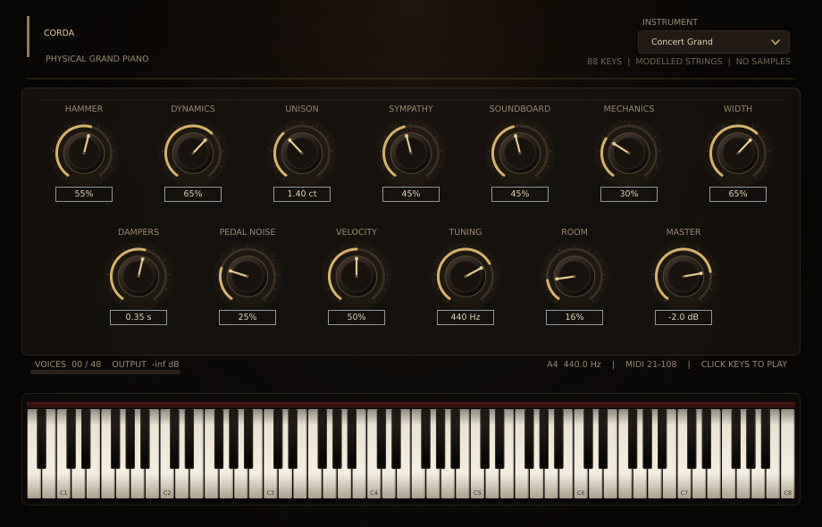

> **Ветка `waveguide-v2`:** экспериментальное ядро 2.1 (волноводы внизу/середине, модальный верх). См. [docs/WAVEGUIDE_PREVIEW.md](docs/WAVEGUIDE_PREVIEW.md). Это preview, не замена v1.2.

# Corda Grand 1.2

**Физически моделируемый концертный рояль для Linux / VST3 / Cockos Reaper.**

Текущая версия: **1.2.0** — исправлены «вечная педаль», перегруз при педали, невнятные пресеты и неестественно быстрое затухание унисона.
88 клавиш, 48 голосов, педаль, симпатический резонанс, звукосниматель-сэмплов — **ноль**. Размер плагина — около 6 МБ, и он не увеличивается от нот к ноте.



Corda Grand — самостоятельная физическая модель, вдохновлённая подходом Modartt Pianoteq и открытыми работами по моделированию фортепиано. Это не клон Pianoteq и не повторение его патентованных алгоритмов: другой движок, другой набор компромиссов, открытый исходный код.

---

## 0. Что нового в 1.2

- **Педаль больше не усиливает звук.** Симпатический резонанс был слишком долгим и громким (фактически «дрон» на 8–12 с); теперь это короткое, тихое «гало» с T60 0.45–0.75 с, high-pass 180 Гц и быстрым демпфером при отпускании педали.
- **Сустейн стал естественным.** Три равноправных унисона могли глубоко гасить друг друга; теперь один основной банк и два тихих расстроенных сайд-банка. Нота держит фундамент, но не превращается в бесконечный хвост.
- **Демпферы быстрее** (T60 ~0.2–0.3 с в среднем регистре), комната по умолчанию суше (16%) — без педали нота реально останавливается.
- **Пресеты INSTRUMENT теперь слышны.** В движке появился отдельный параметр `timbre`; Intimate — заметно темнее и шире по корпусу, Bright — заметно ярче и суше, Vintage — расстроенный и механический.
- **Атака:** усилен деревянный удар молотка и низкочастотный «стук», шум контакта стал короче; добавлен случайный старт 0.1–1.8 мс, чтобы аккорды не щёлкали идеально одновременно.
- Master по умолчанию −2 дБ, больше запаса по перегрузу.

### Что было в 1.1

- короткий нелинейный контактный импульс молотка с компенсацией по модам;
- модальный банк деки 24 моды и ранние отражения;
- две поляризации баса;
- более мягкий строй в верхах;
- калибровка уровней 88 клавиш;
- шумы молотка/демпфера/педали и вариативность от ноты к ноте.

---

## 1. Что внутри

Сигнальный путь:

```
MIDI (velocity, note-off, CC64)
      │
      ▼
модель действия и молотка: скорость, нелинейная жёсткость войлока,
контактное время, точка удара 1/8 длины струны
      │
      ▼
струны: 1–3 унисона × 2 поляризации, модальный банк
(негармоничность f_n = n·f0·√(1+B·n²), растянутый строй Railsback)
      │
      ▼
демпферы и педаль (CC64), симпатический резонанс, дуплекс-шкала
      │
      ▼
корпус/дека: 4 моды 90–245 Гц, ВЧ-спад, стерео-панорама по клавишам
      │
      ▼
алгоритмическая комната + мягкий ограничитель
```

Ключевые свойства:

- **Не сэмплы.** Каждая нота рождается из модальных резонаторов; в плагине нет ни одного аудиофайла.
- **88 клавиш** A0–C8, растянутый строй и негармоничность, зависящая от регистра (таблица B: от 4.3e-4 в басу до 5e-2 у C8).
- **1–3 струны на ноту** и две поляризации с разными временами затухания — это даёт характерные биения унисона и двухступенчатый спад.
- **Молоток** учитывает velocity, curve, жёсткость войлока и точку удара; жёсткий удар даёт короче контакт и больше верхних частичных.
- **Педаль**: CC64 поднимает демпферы; отпущенные ноты продолжают звучать, при снятии педали демпфируются с частотно-зависимым временем.
- **Симпатический резонанс** — отдельный банк 36 мод, возбуждаемый струнами; сильнее всего проявляется при нажатой педали.
- **Механика**: шум контакта молотка, низкочастотный «стук», шум педали и демпферов — синтезированные, не сэмплированные.
- **Стерео**: панорама по клавиатуре плюс разведение унисонов; регулируемая ширина.
- **Комната** — 4-линейный FDN с демпфированием; её можно выключить и использовать ревербератор Reaper.
- **Задержка** — 128 сэмплов (2.7 мс при 48 кГц) из-за look-ahead лимитера; хост компенсирует её автоматически.

## 2. Установка

### Готовый VST3

```bash
./install.sh
```

Скрипт копирует `Corda Grand.vst3` в `~/.vst3/`. Reaper:

1. `Options → Preferences → Plug-ins → VST`
2. убедиться, что путь `~/.vst3` включён;
3. `Rescan`.
4. Найти `Corda Grand (Corda Audio)` в списке VST3i.

Либо скопируйте вручную:

```bash
mkdir -p ~/.vst3
cp -a "build/Corda_artefacts/Release/VST3/Corda Grand.vst3" ~/.vst3/
```

### Сборка из исходников

Зависимости (Arch/CachyOS):

```bash
sudo pacman -S --needed base-devel cmake git alsa-lib freetype2 fontconfig \
    libx11 libxext libxinerama libxrandr libxcursor libgl
```

Ubuntu/Debian-подобные:

```bash
sudo apt install build-essential cmake git libasound2-dev libfreetype6-dev \
    libfontconfig1-dev libx11-dev libxext-dev libxinerama-dev libxrandr-dev \
    libxcursor-dev libgl1-mesa-dev
```

Сборка:

```bash
./build.sh
```

Или вручную:

```bash
cmake -S . -B build -G "Unix Makefiles" -DCMAKE_BUILD_TYPE=Release
cmake --build build --target Corda_VST3 -j"$(nproc)"
./install.sh
```

JUCE 8.0.8 подключён как git-submodule в `third_party/JUCE`. Клонируйте репозиторий рекурсивно:

```bash
git clone --recursive https://github.com/Catophony/Corda_grand_VST.git
# или, если репозиторий уже склонирован:
git submodule update --init --recursive
```

Если `cmake` не установлен, `build.sh` попробует локальный `tools/cmake/bin/cmake`; в git этот каталог не входит — установите CMake обычным способом.

Проверка DSP без хоста:

```bash
./build/corda_selftest
./build/corda_render build/test.wav --note 60 --vel 0.8 --dur 6
./build/corda_render build/demo.wav
```

## 3. Управление

| Параметр | Что делает |
|---|---|
| **Hammer** | Жёсткость войлока: мягкий, округлый звук ↔ яркий, атакующий. Влияет на контактное время и спад верха. |
| **Dynamics** | Чувствительность к velocity. Больше — шире динамический диапазон. |
| **Unison** | Разброс унисонных струн в центах. 1–2 цента — типично для реального рояля. |
| **Sympathy** | Уровень симпатического резонанса и педального «гало». |
| **Soundboard** | Количество резонансов деки и корпуса. |
| **Mechanics** | Уровень шумов молотка, клавиши и демпферов. |
| **Width** | Стерео-ширина: панорама клавиш и разведение унисонов. |
| **Dampers** | Время демпфирования после отпускания клавиши (примерно T60, секунды). |
| **Pedal Noise** | Механический шум педали. |
| **Velocity** | Кривая velocity: мягкая ↔ жёсткая. |
| **Tuning** | Строй A4, 415–450 Гц. |
| **Room** | Встроенная комната. `0%` — полностью сухой звук. |
| **Master** | Выходной уровень, −30…+6 дБ. |
| **Instrument** | Четыре общей настройки: Concert, Intimate, Bright, Vintage. |

Нажимайте клавиши в нижней части интерфейса — они играют (GUI отправляет MIDI в движок). Полноценная игра, конечно, идёт из MIDI-клавиатуры/Reaper.

### MIDI

- Note On/Off, velocity 1–127.
- CC64 (sustain): 0–127; порог около 35%.
- Note-off velocity влияет на скорость опускания демпфера.
- CC123 / All Notes Off.
- Плагин не принимает аудиовход (инструмент).

## 4. Производительность

Замер на 12-ядерном Linux-хосте (один поток аудио, 48k):

- 1 нота: ~1% одного ядра.
- 48 голосов одновременно: **≈7× реального времени** (≈14% одного ядра), тест `corda_selftest`.
- 25-секундный демо-ролик (MIDI `demo/corda_demo.mid`) рендерится в Reaper быстрее реального времени.

Алгоритм не использует FFT/свёртку и не грузит диск. Память — несколько сотен килобайт состояния; сэмплов нет. Задержка плагина — 128 сэмплов, Reaper компенсирует её через PDC.

## 5. Тестирование

- `corda_selftest`: 88 клавиш, 44.1/48/96 кГц, note-off, педаль, экстремальные параметры, полифония 48, отсутствие NaN/Inf, ограничение выхода.
- `pluginval` v1.0.4, strictness 8, включая GUI: **SUCCESS**.
- Реальный рендер в Cockos Reaper 7.82 Linux: MIDI-файл `demo/corda_demo.mid`, дорожка VST3i, офлайн-рендер 48k/24-bit — без ошибок; именно он лежит в `demo/`.
- Демо-аудио: `demo/corda_demo.flac` и `demo/corda_demo.mp3`, исходный MIDI — `demo/corda_demo.mid`. Это рендер через Reaper, а не внутренний тестовый генератор.

## 6. Ограничения и честность

- Это **не** Pianoteq и не заявление о его звуковой идентичности. Модель самостоятельная; часть физики (например, полная нелинейная контактная задача молотка и струны) сведена к калиброванному импульсному возбуждению модальных струн.
- 48 голосов; при плотной педали самые тихие/старые голоса уступаются.
- Нет una corda (CC67), sostenuto (CC66), sympathetic-модели каждой отдельной струны и convolution-реверба. Комната алгоритмическая.
- Нет встроенного менеджера пресетов, кроме четырёх voicing-вариантов; состояние плагина сохраняется хостом.
- Linux x86_64. Сборка под другие ОС теоретически возможна (JUCE), но не проверялась.

## 7. Лицензия

Код Corda Grand распространяется под **GNU GPL v3** (см. `LICENSE`), потому что использует JUCE 8 под GPLv3. Для проприетарного распространения нужна коммерческая лицензия JUCE.

Сторонние компоненты и ссылки — в `NOTICE` и `docs/PHYSICS.md`.

---

**Corda Audio** · 2026 · сделано для Linux и Reaper.
